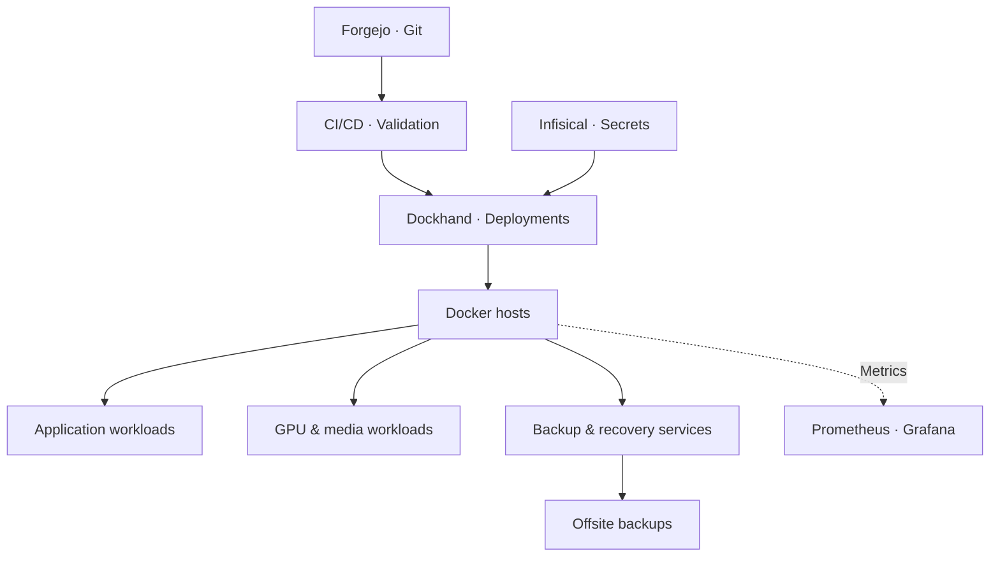

# Hey, I'm Dor 👋

**Troubleshooting · Infrastructure · Automation · Self-hosting**

I enjoy figuring out how things work, why they break, and how to make them better.

My professional background is in Tier 3 technical support, investigating complex production issues across SaaS and on-premises systems, working with R&D teams, and helping other engineers troubleshoot difficult problems.

Outside of work, I run a multi-host homelab. Over time, it has become my playground for DevOps practices, infrastructure automation, self-hosted services and AI agents. I like taking a manual process, understanding its failure points and finding a better way to run it.

## What I'm working on

- **My homelab:** running and maintaining containerized services across multiple hosts.
- **Git-based deployments:** managing Docker Compose configurations in Forgejo, automating deployments and improving validation and recovery workflows.
- **Reliability:** centralized secrets management, monitoring, offsite backups and disaster recovery.
- **AI-assisted operations:** exploring how AI agents can help with technical investigations and day-to-day infrastructure tasks.

### A look inside my homelab

*Simplified view of my personal infrastructure and deployment workflows.*

## Tools I work with

**Systems & troubleshooting**

REST APIs · SQL · Networking · TLS · AWS EC2

**Infrastructure & automation**

Docker Compose · Dockhand · Infisical · CI/CD · AI-agent workflows

## Selected projects

### [Israeli Sure Importer](https://github.com/dorko87/israeli-sure-importer)

A self-hosted integration that imports Israeli bank and credit card transactions into Sure Finance. It runs in Docker and includes scheduled imports, REST API integration, duplicate detection, dry-run mode and failure notifications.

I'm also interested in documenting more of my homelab, including the decisions behind its architecture and the problems I've encountered along the way.

---

I'm open to opportunities in technical engineering, infrastructure, DevOps and automation, building on my experience in production troubleshooting.

[Connect with me on LinkedIn](https://www.linkedin.com/in/dor-konviser-97883364/)
